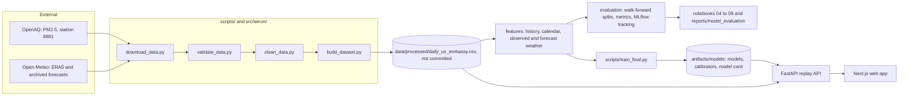

# Architecture

What exists, as of the end of the planned scope. Diagram boxes are code in this repository unless marked external.

## Pieces

| Piece | Where | Notes |
|---|---|---|
| Ingestion, validation, cleaning | `src/aeron/ingest/`, `validation.py`, `cleaning.py`, `processing.py` | Hourly table (UTC) and daily table (local day, at least 18 valid hours). Gaps are never filled. |
| Features | `src/aeron/features/` | One row per forecast origin. Groups: PM2.5 history, calendar of the target day, observed weather up to the origin, archived forecast for the target day. Leakage tests perturb everything after the origin. |
| Evaluation framework | `src/aeron/evaluation/` | Rolling-origin blocks by season, expanding window, a gap equal to the lead, paired block bootstrap, MLflow runs (SQLite store in `mlruns/`, not committed). |
| Models | `src/aeron/models/` | Baselines (persistence, climatology, ridge), random forest, XGBoost, LightGBM, ablation variants. |
| Uncertainty | `src/aeron/uncertainty.py` | Split-conformal intervals (plain and level-scaled) and exceedance probabilities (Platt and conformal). |
| Explanations | `src/aeron/explain.py` | TreeSHAP from LightGBM and permutation importance. |
| Packaging and inference | `src/aeron/forecast.py`, `scripts/train_final.py` | `train_final`, `save`, `ForecastService.forecast`, `known_at`. Artifacts are joblib files plus `model_card.json`; load only files made by this project. |
| API | `src/aeron/api/` | Replay mode: `/health`, `/api/v1/replay/range`, `/api/v1/forecast`, `/api/v1/history`, `/api/v1/station`, `/api/v1/model`. OpenAPI at `/docs`. CORS limited to the frontend origin. |
| Web app | `frontend/` | Dashboard, Forecast, Research. Calls the API from the browser. |

## Replay and why there are two models

The series ends on 2025-02-25, so a current forecast is impossible. The API replays 340 past origin days (2024-01-21 to 2025-02-22). For those days to be out-of-sample, the replay model is trained only on targets up to 2024-01-19, the day before archived forecasts begin. The production model (all data) is built by the same script but is not used for replay. `known_at(daily, origin)` removes PM2.5 and observed weather after the origin before any forecast is made; the weather forecast columns for the target days are kept because they were issued earlier.

## Data flow rules that matter

- A model fitted for a test block sees only rows whose target day is on or before the block's training cutoff, and the cutoff is the block start minus the lead.
- Training uses observed (ERA5) weather in place of the forecast; testing uses real archived forecasts. Observed-weather results are an upper bound.
- Calibration of intervals uses the last training year, forecast by a copy of the model fitted on earlier rows.

## Not built

Database, scheduler, live data feed, hosted deployment, map page, hourly forecasts, deep learning (see `docs/research/limitations.md`).
