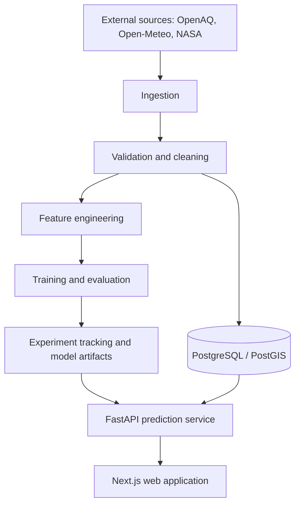

# System architecture

Target architecture. Only components needed by the current phase are built; nothing below is implemented yet.

## Principles

- **Separation of stages.** Ingestion, processing, training, evaluation, inference and presentation are separate modules with explicit inputs and outputs.
- **No training in API requests.** The API loads trained artifacts and serves predictions.
- **One implementation.** Reusable logic lives in `src/aeron/`. The backend imports it, notebooks call it, and neither copies it.
- **Start simple.** Files and local storage come first. PostgreSQL/PostGIS, Airflow and Docker are introduced when the research needs them.

## Module layout

Created when each module gets its first real code:

| Package | Responsibility |
|---|---|
| `data_ingestion` | Fetch from sources into `data/raw/` |
| `validation` | Schema and quality checks |
| `preprocessing` | Cleaning and alignment |
| `features` | Feature construction without leakage |
| `models` | Baselines and ML models |
| `evaluation` | Metrics and walk-forward validation |
| `explainability` | SHAP and error analysis |
| `visualization` | Shared plotting helpers |
