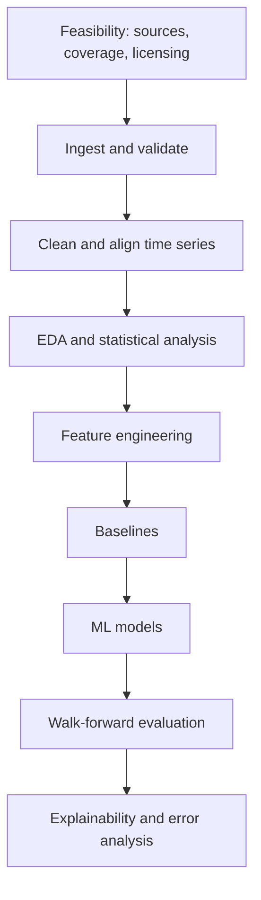

# Methodology

This document describes the planned approach. It will be revised as data availability becomes known.

## 1. Feasibility (Phase 1)

For each candidate dataset, record: source and license, historical coverage, temporal resolution, geographic coverage, missing observations, measurement quality and known limitations. The outcome decides the target, horizons and stations that are viable.

## 2. Data preparation

- Keep raw data unchanged; derive cleaned data by scripted steps.
- Align all series to a common time zone and resolution.
- Treat missing values explicitly. Imputation, if used, is fitted on training data only and documented.
- Flag, do not silently remove, suspected sensor faults and outliers.
- Distinguish measured, estimated and predicted values throughout.

## 3. Exploratory and statistical analysis

Seasonality, diurnal and weekly cycles, distributions, autocorrelation, and associations with weather variables. Tests state their assumptions. Time series are autocorrelated, so tests that assume independence are used with care or avoided.

## 4. Features

Calendar features (with cyclical encoding), PM2.5 and PM10 lags, rolling statistics, and weather variables. Station features when several stations exist.

**Leakage rule:** at forecast origin `t`, a feature may use only information available at `t`. For weather, this means using forecast values for the future, not observed values, or documenting the difference between the two.

## 5. Models

Baselines come first:

1. Historical mean
2. Persistence
3. Seasonal naive
4. Linear regression

Then Random Forest, XGBoost and LightGBM. LSTM or GRU are tried only if the data volume and the results of the earlier models justify them. No model is assumed to be best.

## 6. Evaluation

- Chronological train, validation and test split; no shuffling.
- Rolling-origin (walk-forward) validation where data length permits.
- Metrics: MAE, RMSE, R². MAPE only where values are bounded away from zero.
- Reported per horizon, per station, per season, and for high-pollution episodes.
- Uncertainty via prediction intervals, with their empirical coverage checked.
- Hyperparameters are tuned on validation data; the test set is used once per final comparison.

## 7. Explainability

SHAP for global and local explanations, plus error analysis. Explanations describe model behavior, not causal mechanisms.

## 8. Reproducibility

Fixed random seeds, versioned configs, recorded data retrieval dates, and scripts that regenerate every reported number.
